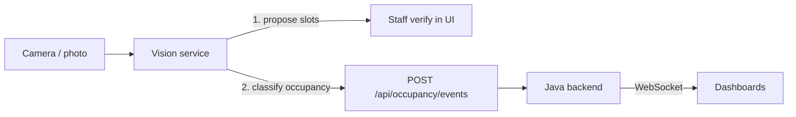

# Camera & Slot Algorithm

How the platform turns a photo or camera frame into parking occupancy, and how
parking slots are decided. The vision service owns no state — it only reports
occupancy events to the Java backend, which remains the source of truth.

## 1. Where it fits



## 2. How parking slots are decided

There are two kinds of parking area, and each gets a different strategy.

### Structured parking (painted bays)
Slots are configured directly by staff: a code (`A01`), a position, and an
optional polygon. No detection required.

### Unstructured parking (open lots, yards, roadsides)
Two algorithms, exposed via `POST /slots/propose`:

**a. Line detection (`mode=lines`)** — for lots with visible markings:
1. Convert to grayscale, blur, run Canny edge detection.
2. Run a probabilistic Hough transform to get line segments.
3. Classify segments as horizontal (rail lines) or vertical (dividers).
4. Merge collinear segments into single spans.
5. Cut a bay between every pair of adjacent dividers, bounded top and bottom by
   the rail line and the divider lengths.
6. Discard bays narrower than 2% or wider than 30% of the image width.

**b. Grid proposal (`mode=grid`)** — when there are no markings, or as fallback:
divide the region of interest into `rows × cols` candidate bays.

`mode=auto` (the default) tries line detection first and falls back to the grid,
reporting which method it used and why.

Either way, proposals become **PROPOSED** spaces in the backend and are shown to
staff, who **verify** or **reject** them. A proposed space can be saved without a
code; a code is required before it can be verified. This keeps a human in the
loop, which the abstract requires for irregular areas.

Every slot is returned both in pixel coordinates and normalized (0..1) so the
frontend can overlay it on the image at any resolution. An annotated PNG overlay
is returned for review.

## 3. How occupancy is detected

`POST /occupancy/detect` scores each slot and classifies it. Two scoring modes:

### a. Difference mode (a reference photo of the empty lot exists)
```
score = min(1, mean(|gray_slot - gray_reference_slot|) / 40)
```
A parked car changes most of the pixels in the slot, so the mean absolute
difference is large. This is the most reliable mode for a fixed camera.

### b. Texture mode (no reference)
A vehicle introduces edges, corners and brightness variance that flat asphalt
lacks:
```
score = 0.50 · norm(Laplacian variance)
      + 0.35 · norm(Canny edge density)
      + 0.15 · norm(intensity std-dev)
```
Each term is normalized to 0..1 by an empirical scale (500, 0.15, 60).

### Decision threshold
Occupancy scores are naturally bimodal (empty vs vehicle), but the empty cluster
is much larger, which biases Otsu's method. Instead the classifier:

1. sorts the scores and finds the **largest gap** between consecutive values;
2. if that gap exceeds 0.15, splits at its midpoint;
3. otherwise falls back to a mode-specific floor (0.10 for difference, 0.30 for
   texture) so noise is never reported as a car.

The threshold can be overridden per request, and it is returned in the response
for traceability.

### Confidence
`confidence = |score − threshold| / max(threshold, 1 − threshold)`, boosted when
a slot repeats its previous state and reduced when it flips.

## 4. Reporting to the backend

`POST /pipeline/run` (or `scripts/demo_pipeline.py`) maps each classified slot to
a backend space id and sends:

```json
{ "spaceId": 6, "state": "OCCUPIED", "source": "CAMERA",
  "confidence": 0.93, "externalId": "CAM-L1:frame-0001:6" }
```

`externalId` makes ingestion **idempotent**: the same frame re-sent returns the
original event id instead of creating a duplicate. The backend then derives the
space state, opens or closes a `ParkingSession`, links an active reservation, and
broadcasts the change over WebSocket.

The bridge keeps an in-memory last-known-state cache so unchanged slots are not
re-sent while the process is running.

## 5. Using it in the app

The **Camera** page (`/camera`, ADMIN and MANAGER) runs both flows on an uploaded
photo, with no command line needed:

- **Propose slots** — choose a zone, upload a lot photo, pick a mode (auto / lines /
  grid) and optionally rows & columns. The annotated overlay shows every proposal;
  **Import as proposed spaces** creates them in the zone as PROPOSED, ready for
  staff to verify or reject in the zone view.
- **Detect occupancy** — upload a frame and (optionally) a reference photo of the
  empty lot. The page maps the zone's spaces to slots, calls the vision service,
  shows the overlay with per-slot score/confidence, and **Push occupancy events**
  posts them to the backend as `CAMERA` events with idempotency keys.

The frontend talks to the vision service directly in development
(`VITE_VISION_URL`, default `http://localhost:8001`) and through nginx `/vision/`
in production. Credentials stay in the frontend: the vision service only analyses
images, and the browser pushes events with its own token.

## 6. Endpoints

| Method | Path | Purpose |
|---|---|---|
| GET | `/health` | Liveness + configured backend |
| POST | `/slots/propose` | Propose slots (mode=auto\|lines\|grid, roi, rows, cols) |
| POST | `/occupancy/detect` | Classify supplied slots (optional reference image, threshold) |
| POST | `/pipeline/run` | Detect and optionally push events (`push=true`) |
| POST | `/bridge/reset` | Clear the last-known-state cache |

Interactive docs: `http://localhost:8001/docs`.

## 7. Running it

```bash
cd vision-service
python -m venv .venv && .venv/bin/pip install -r requirements.txt
.venv/bin/uvicorn app.main:app --port 8001

# end-to-end demo against the running backend
.venv/bin/python scripts/demo_pipeline.py --occupied A06,A08 --push
```

Environment: `PARKING_API_URL`, `PARKING_USER`, `PARKING_PASSWORD`,
`CAMERA_CODE` (see `app/config.py`).

## 8. Honest limitations & roadmap

- **No deep model.** Detection uses classical CV (edges, texture, difference).
  It is explainable and needs no training data, but a YOLO/ONNX vehicle detector
  would be more robust to shadows, rain and partial occlusion.
- **No perspective correction.** A slanted camera compresses distant bays.
  A four-point homography (specified per camera) would fix that; the ROI and
  polygon model already support it.
- **Slot→space mapping is manual today** (the caller supplies `space_id`). A
  camera registry mapping slots to spaces would automate onboarding.
- **No camera capture loop.** Frames are supplied by the caller; an RTSP/file
  poller would make it a true always-on service.
- **Single frame at a time.** Temporal smoothing across frames would reduce
  flicker on borderline slots.
