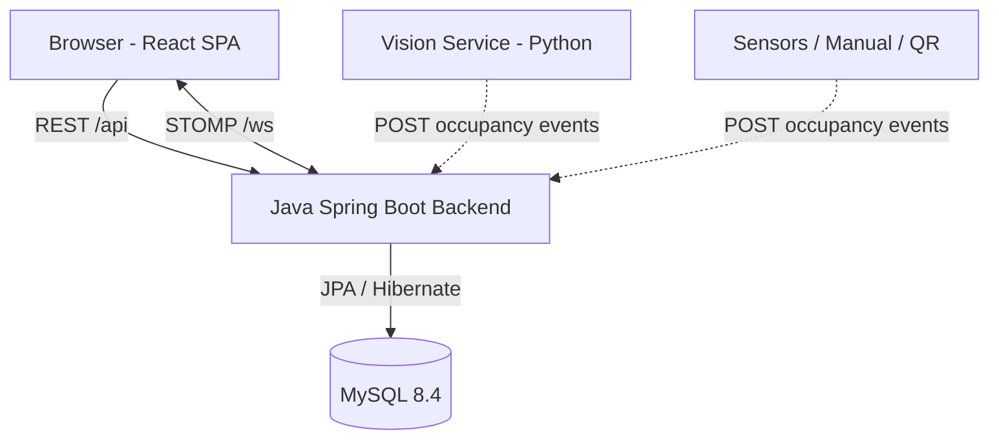
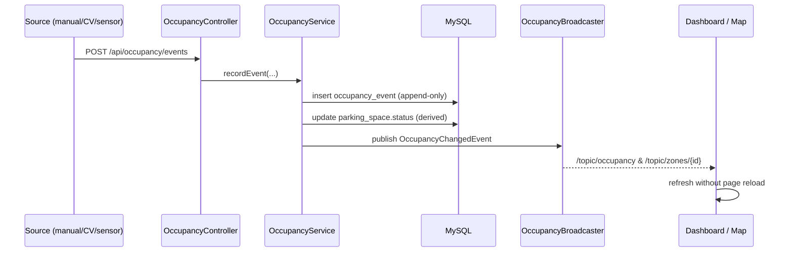

# System Architecture

## Components

- **Backend** is the single source of truth for parking state. It owns the domain model,
  authentication, business rules and the occupancy engine.
- **Frontend** (React + TypeScript) consumes REST for data and STOMP for real-time updates.
- **Mobile app** (Expo / React Native) talks to the same REST + STOMP endpoints,
  deriving the API host from the Expo dev host; tokens live in the device secure store.
- **Vision service** and other detection sources are *external producers*: they only POST
  occupancy events and never own state. In the current software-only build this role is
  filled by manual updates from the UI, which use the identical event interface.
- **MySQL** stores all state plus append-only occupancy history for analytics.

## Occupancy data flow (real-time)

## Layering (backend)

`controller → service → repository → entity`, with `dto`/`mapper` at the boundary and
`security` (JWT filter) + `websocket` as cross-cutting concerns. Services own transactions
and business rules; controllers only translate HTTP.

## Configuration

- Profiles: `dev` (local MySQL, `ddl-auto=update`, SQL logging, demo seed) and `prod`
  (env-var datasource, `ddl-auto=validate` by default, no seed).
- All secrets/URLs in prod come from environment variables (`DB_URL`, `DB_USERNAME`,
  `DB_PASSWORD`, `JWT_SECRET`, `CORS_ALLOWED_ORIGINS`).
