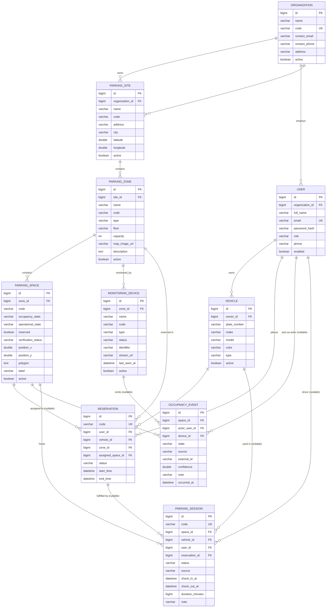

# Entity Relationship Diagram

Database: MySQL 8.4. Schema auto-generated by Hibernate (`ddl-auto=update` in dev).
All tables carry `id`, `created_at`, `updated_at` (audited via Spring Data).

## Enumerations

| Enum | Values |
|---|---|
| `Role` | ADMIN, MANAGER, USER |
| `ZoneType` | STRUCTURED, UNSTRUCTURED |
| `SpaceStatus` | AVAILABLE, OCCUPIED, RESERVED, OUT_OF_SERVICE |
| `VerificationStatus` | PROPOSED, VERIFIED, REJECTED |
| `ReservationStatus` | PENDING, CONFIRMED, ACTIVE, COMPLETED, CANCELLED, EXPIRED |
| `OperationalState` | IN_SERVICE, OUT_OF_SERVICE, MAINTENANCE |
| `SessionStatus` | ACTIVE, COMPLETED |
| `EventSource` | CAMERA, SENSOR, MANUAL, QR, PHOTO |
| `OccupancyState` | OCCUPIED, VACANT, UNKNOWN |
| `DeviceType` | CAMERA, SENSOR, MANUAL |
| `DeviceStatus` | ONLINE, OFFLINE, MAINTENANCE |
| `VehicleType` | CAR, BIKE, SUV, TRUCK, EV, OTHER |

## Design notes

- **OccupancyEvent is append-only.** `ParkingSpace.occupancyState` is a derived cache of the
  latest event (see `OccupancyService.applyStateToSpace`). History is never overwritten.
- **Occupancy vs operational state are separate.** `occupancyState` (OCCUPIED/VACANT/UNKNOWN)
  is written only by occupancy events; `operationalState` (IN_SERVICE/OUT_OF_SERVICE/MAINTENANCE)
  is written only by staff. `reserved` is managed by reservations. The API's `status` field is
  derived from these three, in priority order: operational → occupied → reserved → available.
- **Idempotent events.** `(source, external_id)` is unique; a repeated event from a source
  returns the original event instead of creating a duplicate.
- **ParkingSession links promise to reality.** A check-in event auto-opens a session (linking
  an active reservation, driver and vehicle when present) and a check-out event closes it,
  computes duration, and completes the linked reservation.
- **Unstructured parking:** `ParkingSpace.code` is nullable and `verification_status`
  defaults to `PROPOSED` for spaces without a code; `polygon` + `position_x/y` store the
  mapped geometry until a staff member verifies them.
- **Zone-any reservations:** `assigned_space_id` is optional. When the user does not pick a
  space, `ReservationService` auto-assigns the first available space in the zone.
- **Devices attach at zone level**, not per space, matching camera/zone coverage.
- Unique keys: `organizations.code`, `users.email`, `(site_id, code)` on zones,
  `(zone_id, code)` on spaces and devices, `reservations.code`.
